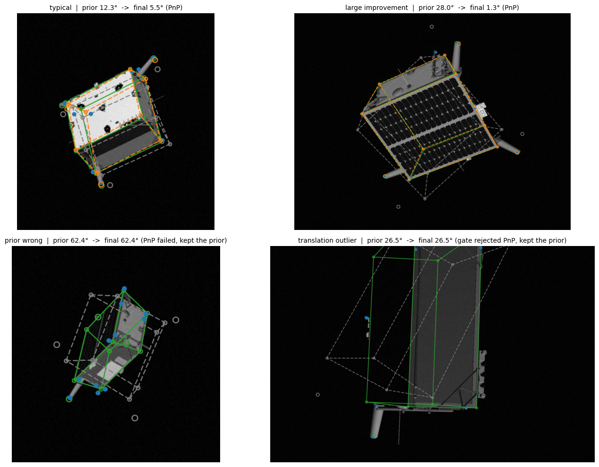
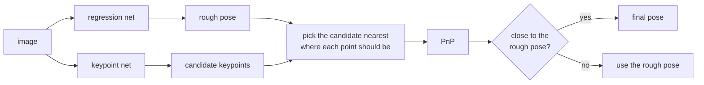
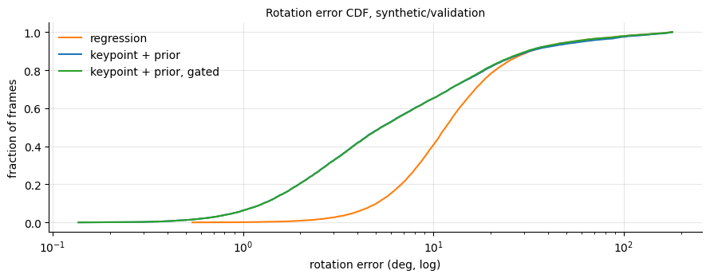

# tumbleweed
tumbling through orbit 

**snake rattle**

**saloon door swings open**

Given one photo of a satellite, figure out exactly how it's oriented and where it is relative to the camera. That's the problem a spacecraft faces when it has to approach something that isn't cooperating, like a dead satellite or a piece of debris. I'm working on it with the Tango satellite from Stanford's [SPEED+](https://purl.stanford.edu/wv398fc4383) dataset.

The eventual goal is tracking: feed these per-frame estimates into a filter that follows a tumbling satellite over time. This repo is the vision half.

**Where it's at:** median rotation error went from **11.6° to 5.4°** by combining two models that are each flawed on their own, without retraining either one.



*Green is the true pose, gray dashed is the rough first guess, blue dots are detected keypoints, and orange dashed is the final answer. The top row is where it works. The bottom row shows the failure cases, which fall back to the rough guess.*

## The short version

1. **Regression.** A ResNet18 looks at the image and guesses the pose directly. It's never wildly lost, but it's sloppy: 11.6° median error.
2. **Keypoints + PnP.** A second network finds 11 known points on the satellite (corners and antenna tips). Since I know where those points sit on the real 3D satellite, OpenCV's PnP solver can work out the pose with geometry. In theory this is far more precise. In practice it failed on 88% of images.
3. **Why it failed.** Tango is almost left/right symmetric, so the detector often couldn't tell corner 1 from its mirror twin, corner 2. It would light up both, pick the wrong one about half the time, and PnP would fall apart. 84% of the big keypoint errors landed exactly on another keypoint's spot.
4. **The fix.** Use the sloppy regression guess to break the tie. Project where each keypoint *should* roughly be, then pick whichever detected blob is closest. Regression knows left from right, and the keypoints and PnP supply the precision.
5. **One more catch.** Occasionally a few bad points agree on a nonsense answer. My favorite was the satellite placed 6.4 km away when it was actually 3 m away. So if PnP's answer wildly disagrees with the regression guess, it gets thrown out.



## Results

Measured on all 11,994 validation images. SPEC is the official SPEED+ score, which combines rotation and translation error, and lower is better.

| method | median rotation error | median position error | SPEC |
|---|---|---|---|
| regression | 11.6° | 18.6 cm | 0.354 |
| keypoints + PnP | (fails on 88% of images) | | 5.86 |
| keypoints + PnP + regression tiebreak | 5.3° | 11.8 cm | 0.613 |
| **+ throw out nonsense answers** | **5.4°** | **11.7 cm** | **0.276** |

The third row is a good example of why one number isn't enough. Its typical error is great, but ten absurd outliers wrecked the average. Filtering them out made the final version better than regression across the board.



*Most images get a lot better: 65% land under 10°, compared with 41% for regression. The worst ~10% don't improve, because those are the images where the regression guess itself was way off.*

Before trusting any of this, I checked the geometry by itself by feeding PnP perfect keypoints with added noise. With 2 pixels of noise it's off by only 0.3°, so the math works, and any remaining error comes from the detector (`notebooks/pnp_validation.ipynb`).

## What's not great yet

- These are rendered images. SPEED+ also has real lab photos, and I haven't tested on those yet.
- When the regression guess is badly wrong, it steers the keypoint selection wrong too, so the worst cases didn't improve.
- The keypoint detector's points are about 16 px off on average, which caps this setup at around 4°. Retraining it is next.
- This isn't meant to compete with published results. These are small models trained on a laptop, and the point was understanding where and why each approach breaks.

## What's next

- [ ] Retrain the keypoint detector on crops zoomed in on the satellite
- [ ] Build a tracking filter (an EKF) for a tumbling satellite. Once it's running, the filter's own prediction can replace the regression tiebreaker.
- [ ] Test the tracker on real image sequences from [SHIRT](https://purl.stanford.edu/zq716br5462)

## Running it

```
uv sync --extra dev
```

Put SPEED+ in `data/speedplusv2/` (see `data/README.md`). Add `--device mps` on a Mac or `--device cuda` on NVIDIA.

```
# train
uv run python -m tumbleweed.train                 # regression
uv run python -m tumbleweed.train_keypoints       # keypoint detector

# evaluate the final pipeline
uv run python -m tumbleweed.eval --model keypoint --checkpoint checkpoints/keypoint/best.pt \
    --prior-checkpoint checkpoints/best.pt --advanced --error-csv results/keypoint_prior_gated_val.csv

# tests
uv run pytest
```

The notebooks have the details: `regression_baseline.ipynb` for the first model, and `pnp_validation.ipynb` for the geometry checks, the keypoint detector and the tiebreak.

## Credits

- [SPEED+](https://purl.stanford.edu/wv398fc4383) dataset: Stanford Space Rendezvous Lab and ESA
- Tango keypoint model: [tpark94/speedplusbaseline](https://github.com/tpark94/speedplusbaseline) (MIT), following Park, Sharma & D'Amico ([arXiv:1909.00392](https://arxiv.org/abs/1909.00392))
- [SHIRT](https://purl.stanford.edu/zq716br5462) tracking sequences: Park & D'Amico ([arXiv:2206.03796](https://arxiv.org/abs/2206.03796))
